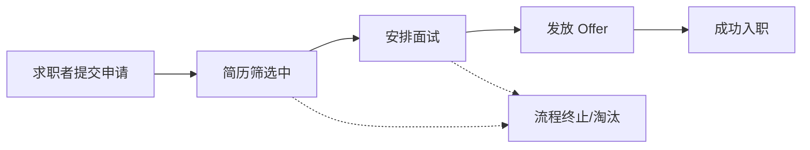

# YQuest 前端项目 (yquest-front)

<p align="center">
  
</p>

<p align="center">
  <strong>你的追求，我们的推荐 —— 一站式企业内推与求职职场交流平台</strong>
</p>

<p align="center">
  
  
  
  
  
  
  
</p>

---

## 📖 项目简介

**YQuest** 是一款面向求职者与企业员工/招聘人员的现代化内推求职与职场互动平台。平台以“缩短求职路径、提升求职效率”为核心，打通求职者、内部推荐人及平台运营三方协同。

本项目为 **YQuest** 的前端单页面应用（SPA），基于 **Vue 2 + Element-UI + Vuex + Vue Router** 构建，涵盖门户展示、内推广场、官方全流程内推跟踪、职场互动圈子、实时 WebSocket 消息推送体系，以及完整的功能完善的运营管理后台。

---

## ✨ 核心功能模块

### 1. 🌐 门户首页 (Portal & Showcase)
- **品牌展示区 (Hero Section)**：核心优势传达与快捷操作指引。
- **特色优势矩阵**：快速入职、优质岗位、直接沟通与全程保障。
- **热门内推职位卡片**：直观展示顶尖企业最新内推职位与直达通道。

### 2. 🔍 内推广场与发布 (Referral Hub)
- **内推机会检索**：按企业名称、行业分类（互联网/金融/电商/医疗等）模糊检索与即时重置。
- **内推码即时获取**：卡片式展示企业内推码、联系人及快速投递链接。
- **发起内推**：企业在职员工/HR 自主发布内推码及招聘职位，支持完备的表单多列排版与字段校验。

### 3. 🚀 官方内推全流程中心 (Official Refer Process)
- **全流程节点可追踪**：标准化闭环链路：`提交申请` → `简历筛选` → `面试安排` → `Offer 发放` → `成功入职`。
- **多角色协同支持**：
  - **求职者视图**：浏览官方在招职位大厅、提交投递申请、实时追踪各节点流转状态。
  - **企业 / 审批人员视图**：根据权限动态展示审批标签页，支持推进与流转候选人进度。
  - **管理员快速引导**：自动识别管理员角色，引导至中台统一管控。

### 4. 💬 职场圈子互动社区 (Career Circles)
- **双层分类架构**：左侧一级大类导航 + 顶部二级分类标签动态联动。
- **动态交流与问答**：支持在线发布动态、话题讨论、求职经验分享与点赞互动。

### 5. 🔔 实时消息通知系统 (Real-time Notification)
- **WebSocket 原生封装**：单例长连接，集成 **25 秒心跳保活（ping/pong）** 与 **5 秒断线自动重连**。
- **即时通知流转**：导航栏未读数红点实时更新、下拉抽屉式通知面板展示，支持一键已读与跳转详情。

### 6. 🛡️ 运营后台管理系统 (Admin Management)
- **权限与用户管理 (User)**：查看注册用户信息、状态管控与账号权限维护。
- **内推管理 (Refer)**：统一审核用户发起的内推码及官方岗位信息，规范内容真实性。
- **圈子分类管理 (Circle)**：维护社区分类结构，支持新增、修改与层级调整。
- **敏感词内容安全 (Sensitive)**：违规词库过滤规则维护，保障社区健康讨论氛围。
- **试用码 / 邀请码管理 (Trial Code)**：用于内部内测或企业入驻邀请码的生成、核销与状态跟踪。

---

## 🛠️ 技术栈

| 分类 | 技术选型 | 说明 |
| :--- | :--- | :--- |
| **核心框架** | [Vue.js 2.6.14](https://v2.vuejs.org/) | 渐进式前端 JavaScript 框架 |
| **构建工具** | [Vue CLI 5.0.0](https://cli.vuejs.org/) | 基于 Webpack 5 的现代化前端脚手架 |
| **UI 组件库** | [Element-UI 2.15.3](https://element.eleme.cn/) | 桌面端经典组件库 |
| **图标库** | [FontAwesome 7.x](https://fontawesome.com/) + Element Icons | 矢量图标集 |
| **路由管理** | [Vue Router 3.5.1](https://router.vuejs.org/) | SPA 单页面路由管理，集成双层鉴权守卫 |
| **状态管理** | [Vuex 3.6.2](https://vuex.vuejs.org/) | 全局用户状态、角色列表、实时通知状态管理 |
| **网络请求** | [Axios 1.11.0](https://axios-http.com/) + qs | 封装请求/响应拦截器，自动附带 Authorization Token |
| **实时通讯** | 原生 WebSocket | 心跳保活、断线重连、事件监听与状态驱动 |
| **样式体系** | CSS Design Tokens + Global CSS | 统一设计变量、自适应网格与 Flex 布局 |

---

## 📁 目录结构

```text
yquest-front/
├── public/                 # 静态资源与 HTML 模板
│   ├── favicon.ico         # 网站图标
│   └── index.html          # 入口 HTML
├── src/
│   ├── assets/             # 样式与公共静态资源
│   │   ├── design-tokens.css # 设计系统 CSS 变量
│   │   ├── global.css        # 全局基础样式与重置样式
│   │   └── logo.png          # 平台 Logo
│   ├── components/         # 公共可复用组件
│   │   ├── EmptyState.vue       # 空状态展示组件
│   │   ├── NavBar.vue           # 顶部全局导航栏
│   │   ├── NotificationBell.vue # 实时通知铃铛（未读角标）
│   │   ├── NotificationPanel.vue# 消息通知抽屉面板
│   │   ├── ReferApplyPanel.vue  # 内推申请弹窗/抽屉组件
│   │   └── UserMenu.vue         # 用户头像与下拉菜单
│   ├── router/             # 路由配置
│   │   └── index.js        # 路由映射表与双角色鉴权守卫 (beforeEach)
│   ├── store/              # Vuex 状态管理
│   │   ├── modules/
│   │   │   └── notification.js # 消息通知模块 (未读计数/消息列表)
│   │   └── index.js        # 根 Store (用户登录态、角色 roles 等)
│   ├── utils/              # 常用工具函数
│   │   ├── errMsg.js       # 接口错误码与提示映射
│   │   └── socket.js       # WebSocket 单例保活与重连机制封装
│   ├── views/              # 页面视图组件
│   │   ├── author/         # 关于作者 / 个人主页
│   │   │   └── authorView.vue
│   │   ├── circle/         # 社区圈子页面
│   │   │   └── circleView.vue
│   │   ├── login/          # 认证授权页面
│   │   │   ├── loginView.vue      # 普通用户登录/注册
│   │   │   └── adminLoginView.vue # 管理员后台登录
│   │   ├── manage/         # 后台管理系统
│   │   │   ├── manageContainer.vue# 管理后台侧边栏布局
│   │   │   ├── UserView.vue       # 用户管理
│   │   │   ├── SensitiveView.vue  # 敏感词安全过滤
│   │   │   ├── CircleView.vue     # 圈子分类管理
│   │   │   ├── manageReferView.vue# 内推信息审核与管理
│   │   │   └── TrialCodeView.vue  # 试用码/邀请码维护
│   │   └── yquest/         # 内推业务核心页面
│   │       ├── yquestView.vue     # 平台首页
│   │       ├── referView.vue      # 发起内推页面
│   │       ├── showReferView.vue  # 内推广场 / 机会浏览
│   │       └── officialReferView.vue # 官方内推流程与审批流转
│   ├── App.vue             # 根组件
│   └── main.js             # 入口文件 (挂载 Element-UI、Axios 拦截器、Store、Router)
├── babel.config.js         # Babel 编译配置
├── jsconfig.json           # 路径别名与 JavaScript 语言服务配置
├── package.json            # 项目依赖与 Scripts 配置
└── vue.config.js           # Vue CLI 配置文件 (开发服务器、API 与 WS 代理)
```

---

## 🚀 快速上手

### 1. 环境准备
请确保本地已安装 [Node.js](https://nodejs.org/)（推荐版本 **v14.x** 或 **v16.x**）以及包管理工具（npm、yarn 或 pnpm）。

```bash
# 检查 Node 版本
node -v
# 检查 npm 版本
npm -v
```

### 2. 获取代码与安装依赖
```bash
# 克隆项目仓库
git clone https://github.com/lj-right/yquest-front.git
cd yquest-front

# 安装依赖（推荐使用 npm 或 pnpm）
npm install
# 或者
pnpm install
```

### 3. 本地启动开发服务器
```bash
npm run serve
```
启动成功后，浏览器访问：[http://localhost:8080](http://localhost:8080)

### 4. 生产构建打包
```bash
npm run build
```
构建产物将输出至根目录的 `dist/` 文件夹中，可直接部署至 Nginx 或静态托管服务。

### 5. 代码质量检查与修复
```bash
npm run lint
```

---

## ⚙️ 网络代理与后端联调

项目默认在 `vue.config.js` 中配置了本地开发代理，反向代理至后端服务端口（默认 `http://localhost:5555`）：

```javascript
module.exports = {
  devServer: {
    port: 8080,
    proxy: {
      // HTTP RESTful 接口代理
      '/api': {
        target: 'http://localhost:5555',
        pathRewrite: {
          '^/api': '' // 剔除 /api 前缀后转发
        }
      },
      // WebSocket 通知通道代理
      '/chicken': {
        target: 'http://localhost:5555',
        ws: true,
        changeOrigin: true
      }
    }
  }
};
```

> **提示**：若后端服务运行在其他主机或端口，请同步修改 `vue.config.js` 中的 `target` 地址并重启开发服务。

---

## 🔐 路由与权限设计

系统在 `src/router/index.js` 中统一实现了全局路由守卫（`beforeEach`）：

```mermaid
flowchart TD
    Start[路由跳转] --> CheckAuth{需身份认证 requireAuth?}
    CheckAuth -- 否 --> Allow[正常放行 next()]
    CheckAuth -- 是 --> CheckAdmin{需管理员权限 isAdmin?}
    
    CheckAdmin -- 是 --> HasAdminToken{存在 adminToken?}
    HasAdminToken -- 是 --> Allow
    HasAdminToken -- 否 --> RedirectAdmin[提示并重定向至 /admin/login]
    
    CheckAdmin -- 否 --> HasToken{存在 userToken?}
    HasToken -- 是 --> Allow
    HasToken -- 否 --> RedirectUser[提示并重定向至 /login]
```

- **普通用户凭据**：存储于 `localStorage.getItem("token")`，并在 Axios 拦截器中自动挂载到请求头 `Authorization`。
- **管理员凭据**：存储于 `localStorage.getItem("adminToken")`，独立隔离管理后台权限。

---

## 🔄 官方内推业务流转

官方内推（`officialReferView.vue`）采用状态机驱动全流程流转：



- 每一阶段均通过状态变更驱动视图更新。
- 后端通过 WebSocket 实时触发状态变更通知至对应用户的消息面板，无需手动频繁刷新。

---

## 🤝 贡献与反馈

欢迎提交 Issue 和 Pull Request 来完善 **YQuest**：

1. Fork 本仓库
2. 新建功能分支 (`git checkout -b feature/amazing-feature`)
3. 提交修改 (`git commit -m 'feat: add some amazing feature'`)
4. 推送至远程分支 (`git push origin feature/amazing-feature`)
5. 创建 Pull Request

---

## 📄 开源许可证

本项目基于 [MIT License](LICENSE) 开源。
